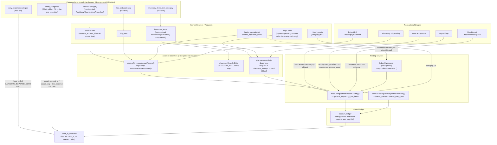

# IntelliCare HMIS — Accounting Map Report

**Scope:** Read-only investigation of how categories, products, services and
every module connect to the chart of accounts and post to the general
ledger. No code, data, schema or config was changed to produce this report.

**Method:** Direct code reading across `src/server/` (routes, services,
models, migration/config scripts) and `src/` (frontend pages that manage
categories or accounts). Every claim below is tied to a file path and line
number as read at the time of this investigation. Where something could not
be confirmed, it is marked **not found** or **unclear** rather than guessed.

---

## 1. One-page summary

IntelliCare's accounting sits on one real table, `chart_of_accounts`
(flat — no parent/child hierarchy, scoped per `clinic_id`, 55 default
accounts seeded by `initializeChartOfAccounts.js`), and one core posting
primitive, `AccountingService.createGLEntry()`
(`src/server/services/AccountingService.js:109-242`), which writes a
balanced debit/credit entry across three tables (`general_ledger`,
`gl_line_items`, `account_ledger`) and enforces `|debits − credits| ≤ 0.01`.
A second, newer helper, `JournalPostingService.postJournalEntry()`
(`src/server/services/JournalPostingService.js:49-122`), does the same job
through a **different** pair of header/line tables (`journal_entries`,
`journal_entry_lines`) but writes to the **same** `account_ledger` table —
so the system has two parallel posting pipelines feeding one shared ledger
that reports actually read from. Reversal is always a new offsetting entry;
nothing is ever deleted from the ledger.

**Categories are the weakest part of the design.** There is no central
"Categories" admin screen anywhere. Every category concept — item/drug
category, service category, lab test category, expense category, stock
location type — is a separate hard-coded JavaScript array baked into its
own page component, not a database table. The one clean exception is
**Fixed Asset categories** (`asset_categories`), which is a real table with
a real foreign key and three explicit account columns
(`asset_account_id`, `accumulated_depreciation_account_id`,
`depreciation_expense_account_id`) — proving the pattern the rest of the
system could have used but didn't.

Because categories are mostly free text, **account resolution happens
through regex/keyword matching and hard-coded lookup maps**, not through a
category→account table. Worse, three independent resolution engines exist
for conceptually the same problem (`resolveRevenueAccount.js`'s regex map
for billing revenue, `pharmacyCogsOnBill.js`'s `CATEGORY_ACCOUNTS` map for
generic-bill COGS, and `pharmacyModule.js`'s drug-column/settings chain for
formal dispensing) — the same physical drug can legitimately post to
different GL accounts depending on which screen sold it.

Most modules DO post correctly and atomically (patient bill creation,
payments in base and foreign currency, GRN acceptance, payroll payment,
fixed-asset depreciation/disposal). But there are real, confirmed gaps:
hard-deleting a bill never reverses its GL entry; pharmacy returns reverse
revenue but never the matching COGS/inventory entry; the UI's actual stock
write-off screen has zero GL effect (a different, unused generic endpoint
does); cashier shift variances are stored as a number but never posted;
and a triggerable FX "revaluation" endpoint updates a balances table but
**never actually posts a GL entry** (unlike the narrower *realized* FX
gain/loss that does post on actual foreign-currency settlement). Payroll
has no reversal/void path anywhere, which is explicitly flagged as
incomplete in the code's own comments.

---

## 2. Category types — full table

| Category type | Where stored | Managed in UI? | Used by | Linked to accounts? |
|---|---|---|---|---|
| Item/inventory category | `inventory_items.item_category`, free text, default `'general'` (`src/server/scripts/migrateInventoryTables.js:30`) | Yes — `src/pages/inventory/ItemMaster.tsx` at `/inventory/items`, but the dropdown is a hard-coded array `CATEGORIES` (`ItemMaster.tsx:62`), not a DB table | String-matched in `inventory.js:63,500,1833-1836,1864` | Indirectly only — see §3 Item Master |
| Stock location type | `stock_locations.location_type`, free text, default `'warehouse'` | Yes — `src/pages/inventory/StockLocations.tsx` at `/inventory/locations`, hard-coded array `LOCATION_TYPES` (line 35) | Cosmetic icon selection only (`StockLocations.tsx:241`) | None |
| Service category | `services.category`, required text column (`src/server/models/Service.js:18-23`) | Yes — `src/pages/setup/Services.tsx` at `/setup/services`, hard-coded array `serviceCategories` (lines 111-121) + fuzzy `normalizeCategory()` for CSV import (line 124) | `lab_tests.service_id` (loose FK, no DB constraint, comment at `labTests.js:24`); `radiology.js:35` filters `category IN ('Radiology','Examination')`; `TheatreService.js:72` filters `category='Procedure'` | **Real link**: `services.revenue_account_id`, set at create/update time via `resolveRevenueAccount(category, clinicId)` — a hard-coded regex→code map (`src/server/utils/resolveRevenueAccount.js:6-29`), not a lookup table |
| Lab test category | `lab_tests.category` (text, required) and a **dead** `lab_tests.category_id` (UUID) column | Yes for `category` — `src/pages/setup/LabTests.tsx`, hard-coded array `testCategories` (line 23). `category_id` has no route/UI anywhere | `patientBills.js:225` matches by `LOWER(test_name)`, not category | No direct account column; resolved at billing time by forcing category `'laboratory'` once a `lab_tests` name-match hits (`resolveRevenueAccount.js:67`) → code `4110` |
| Drug category | Not its own concept — reuses `inventory_items.item_category`, relabeled `therapeutic_category` in pharmacy queries (`pharmacyModule.js:89,159,2443`) | Same as item category | Pharmacy screens | See §3 — dispensing uses a **separate** per-drug column, ignoring this field entirely |
| Expense category | `daily_expenses.category`, free text (`src/server/models/DailyExpense.js:30-33`) | Yes — `src/pages/procurement/DailyExpenses.tsx`, hard-coded array `EXPENSE_CATEGORIES` (line 48) | n/a | **Real, hard-coded posting link**: `CATEGORY_EXPENSE_CODE[category] \|\| DEFAULT_EXPENSE_CODE` picks the debit expense account at pay time (`src/server/routes/daily-expenses.js:44-57,743-744`) — invisible in the UI; the account the user picks in the form is only the *credit* (cash/bank) side |
| Expense invoice category | `expense_invoices.expense_category` (text, `src/server/models/ExpenseInvoices.js:62-65`) | Not located during this pass — **unclear** | n/a | Not found wired to any GL lookup — **unclear/unconfirmed** |
| Fixed asset category | `asset_categories` table, real FK `fixed_assets.category_id` | Yes — `CategoriesDialog` inside `src/pages/accounting/FixedAssetsLayout.tsx` (lines 111-244), mounted at `/accounting/fixed-assets` | Enforced FK — can't delete/re-point once assets exist (`fixedAssets.js:104-116,137-150`) | **Direct explicit account columns on the category row**: `asset_account_id`, `accumulated_depreciation_account_id`, `depreciation_expense_account_id` (`fixedAssets.js:70-87`), each a real FK to `chart_of_accounts` |
| Supplier/vendor category | **Not found** — `accounting_suppliers` has no category/type column (`migrateAccountingTables.js:181-199`), only its own `account_id` (AP sub-ledger account) | No | n/a | n/a |
| Department/clinic type | **Not found** — `departments` has no type/category column (`migrateDepartments.js:10-21`) | Plain CRUD only | n/a | n/a |
| Radiology "category" (Radiology vs Examination) | Same `services.category` column as above — `radiology.js:22-24` explicitly documents this is a filter on the generic services table, not a separate catalog | Same `Services.tsx` screen, no radiology-specific UI | `radiology.js:35` | Same regex resolver as services, bucketed to code `4130` |
| Theatre procedure category | `services.category = 'Procedure'` | Same `Services.tsx` screen | `TheatreService.js:53,72` | Billed with `revenueCategory:'procedure'` (`TheatreService.js:588`) → regex bucket `4140` |
| Theatre consumed-item category | `theatre_operation_items.item_category`, copied verbatim from `inventory_items.item_category` at the moment of use | No edit UI — derivative field | n/a | Drives `revenueCategory: item.item_category==='drugs' ? 'pharma' : 'theatre'` (`TheatreService.js:818-824`), re-run through the same regex resolver |

### Item Master — category-to-account resolution, precisely

The category dropdown in `ItemMaster.tsx:62-64` is a hard-coded array; there
is **no `item_categories` table anywhere** in the codebase. `item_category`
on `inventory_items` is a plain VARCHAR, not a foreign key. Three
**independent** code paths decide the actual GL accounts for an item, with
different precedence and different fallback tables:

1. **Item Master UI itself** lets a user attach `inventory_account_id`,
   `cogs_account_id`, `revenue_account_id` directly to one item (labelled
   "Use category default" when blank — `ItemMaster.tsx:533-560`); these are
   real FK columns to `chart_of_accounts` (`migrateInventoryTables.js:48-51,82`).
2. **Billing a drug as a generic bill line** (`src/server/utils/pharmacyCogsOnBill.js`):
   per-item `cogs_account_id`/`inventory_account_id` wins if set
   (lines 145-150); otherwise falls to a hard-coded `CATEGORY_ACCOUNTS` map
   keyed by `item_category` (lines 77-83, e.g. `drugs → 5210/1310`).
3. **The formal Pharmacy `/dispensing` endpoint** (`pharmacyModule.js:1757-1830`)
   **ignores `item_category` completely**: per-drug `drugs.revenue_account_id`/
   `cogs_account_id` (a column on a *separate* `drugs` table) → clinic-wide
   `pharmacy_settings.pharmacy_revenue_account_id`/`pharmacy_cogs_account_id`
   → hard-coded fallback `5210`/`1310`.

So category is never itself an account — only ever a fallback key into one
of several hard-coded maps, and the three paths can disagree for the same
physical drug depending on which screen sold it.

### Services / lab / radiology / theatre revenue resolution

The real dispatcher at billing time is `resolveRevenueAccountForLine()`
(`resolveRevenueAccount.js:54-91`), checked in this order: explicit
`line.revenue_account_id` → explicit `line.revenueCategory` → `services`
category by id/name → forced `'laboratory'` if the name matches
`lab_tests` → `inventory_items.revenue_account_id` forced `'pharmacy'` →
keyword regex on the raw line name → default code `4100`. The regex buckets
(`resolveRevenueAccount.js:6-29`): lab/diagnostic/pathology → **4110**;
pharmacy/drug/medication/dispense → **4120**; radiology/imaging/x-ray/scan →
**4130**; procedure/surgery/theatre/operation → **4140**;
inpatient/admission/bed/ward → **4150**; consult/OPD/clinic visit →
**4105**; everything else → **4100**.

### Duplicates / inconsistencies (categories)

1. No central categories admin screen anywhere — five independent
   hard-coded JS arrays (`ItemMaster.tsx:62`, `Services.tsx:111`,
   `LabTests.tsx:23`, `DailyExpenses.tsx:48`, `StockLocations.tsx:35`), no
   shared source, easy to drift (CSV import even needs fuzzy-matching
   around it, `Services.tsx:627-645`).
2. `lab_tests.category_id` is a dead column — declared in the Sequelize
   model (`src/server/models/index.js:212`) with no table/route/UI using it.
3. "Drug category" isn't its own concept, yet dispensing accounting
   ignores it entirely in favor of a different per-drug override.
4. Three independent, inconsistent account-resolution engines for the same
   underlying problem (listed above) — can produce different GL accounts
   for the same physical drug.
5. Radiology has no catalog of its own — confirmed by its own code comment
   to be a filter on `services.category`.
6. Supplier/vendor categories and department/clinic types don't exist at
   all in this schema.
7. Fixed asset categories are the one properly normalized example —
   real table, real FK, real three-account linkage, immutability enforced
   once used.
8. Expense categorization doubles as a label and a hidden GL-posting key —
   the account the user actually picks in the Daily Expense form is only
   the credit/payment side; the debit/classification account comes from an
   invisible hard-coded map (`daily-expenses.js:44-57`).

---

## 3. Chart of Accounts & posting architecture

**Table `chart_of_accounts`** (`src/server/scripts/migrateAccountingTables.js:15-35`):
`id` (UUID), `clinic_id`, `account_code`, `account_name`, `account_type`
(asset/liability/equity/revenue/expense), `sub_account_type`, `balance_type`
(debit/credit), `opening_balance`/`opening_balance_date`, `is_active`,
`is_bank_account`/`is_customer_account`/`is_supplier_account` flags,
`description`, audit columns. `UNIQUE(clinic_id, account_code)`
(line 33) — **flat, no parent/child hierarchy, no currency column.**

A separate, apparently legacy `LedgerAccount` model/`ledger_accounts` table
(`src/server/models/LedgerAccount.js:24-30`, routes in
`src/server/routes/ledger-accounts.js`) **does** have a self-referencing
`parent_account_id`, but neither `AccountingService.js` nor
`JournalPostingService.js` nor any posting route ever uses it — it appears
to be a separate, parallel system that the real posting code ignores.

**Scoping**: one chart per `clinic_id` (two clinics can share a code since
uniqueness is per-clinic); the app is additionally schema-per-tenant at the
Postgres level. Branch-level: `chart_of_accounts` and `exchange_rates` are
explicitly shared across branches, not branch-scoped — only transactional
tables got a `branch_id` column added later
(`src/server/config/ensureBranchIsolationColumns.js:43-47,104-117`).
`general_ledger`/`gl_line_items` have **no `branch_id` at all** (comment,
`AccountingService.js:207-214`), so branch-filtered reports read
`account_ledger` directly instead.

**Currency**: not on `chart_of_accounts`. Base currency comes from a
`currencies` table with `is_base_currency = TRUE`
(`src/server/services/CurrencyService.js:13-15`), falling back in code to
`SSP` if no row exists.

**Seeding** (`src/server/scripts/initializeChartOfAccounts.js`, array
`healthcareChartOfAccounts` lines 45-546) — 55 default accounts:

- **Asset (1100–1590)**: 1100 Cash, 1105 Cash at Hand, 1108 Petty Cash,
  1110 Bank-Main, 1120 Bank-Savings, 1200 AR-Patients, 1210 Insurance
  Receivables, 1300 Medical Supplies Inventory, 1310 Pharmaceutical
  Inventory, 1320 Office Supplies Inventory, 1400 Prepaid Expenses,
  1500 Medical Equipment, 1510 Lab Equipment, 1520 Office Equipment,
  1530 Building & Improvements, 1590 Accum. Depreciation-Equipment.
- **Liability (2100–2500)**: 2100 AP-Suppliers, 2110 Accrued Expenses,
  2150 Patient Deposits Held, 2200 Payroll Liabilities, 2210 PAYE Payable,
  2220 NHIF Payable, 2230 NSSF Payable, 2300 VAT Payable, 2400 Short-term
  Loans, 2500 Long-term Loans.
- **Equity (3100–3300)**: 3100 Owner's Capital, 3200 Retained Earnings,
  3300 Owner's Drawings.
- **Revenue (4100–4900)**: 4100 Patient Services Revenue, 4105 Consultation
  Revenue, 4110 Lab Revenue, 4120 Pharmacy Sales Revenue, 4130 Radiology
  Revenue, 4140 Procedure Revenue, 4150 Inpatient Revenue, 4200 Insurance
  Revenue, 4900 Other Income.
- **Expense (5100–5900)**: 5100 Salaries & Wages, 5110 Doctor Fees,
  5120 Employee Benefits, 5200 Medical Supplies Expense, 5210 Pharmaceutical
  COS, 5220 Lab Supplies Expense, 5300 Rent, 5310 Utilities, 5320 Insurance
  Expense, 5330 Maintenance & Repairs, 5400 Office Supplies Expense,
  5410 Marketing, 5420 Professional Fees, 5430 Training, 5440 Administrative
  Expenses, 5500 Depreciation, 5600 Interest Expense, 5610 FX Gain/Loss,
  5700 Bad Debt Expense, 5800 Travel & Transport, 5900 Miscellaneous
  Expenses.

28 of these (`ESSENTIAL_ACCOUNT_CODES`, lines 14-43) are auto-activated;
the rest seed `is_active:false`. **Two codes used elsewhere are not in this
catalogue at all** — `1250` (Employee Advances Receivable) and `5230`
(billing discount), `5910` (loss on disposal) — these rely entirely on
being created ad hoc / manually.

### Self-healing / forced reactivation logic

| Codes | File:line | Reason |
|---|---|---|
| 5100, 5110, 2200 | `src/server/config/ensureHRTables.js:427-432` | Runs on every DB connection; payroll's `/pay` step fails with "accounts are missing" if any of the three is inactive, even though the row exists |
| 5200, 5310, 5330, 5440, 5800 | `src/server/scripts/ensureDailyExpenseAccounts.js:16-52` | Runs on every boot; `getAccountByCode` only returns active accounts, so a tenant provisioned before a daily-expense category's account was marked essential silently failed to post (expense still marked paid, only logged) |
| Full essential set (28 codes) | `src/server/scripts/leanChartOfAccounts.js:54-85,134-170` | Manual ops script; force-creates/reactivates essentials, deactivates genuinely unused non-essentials (never deletes, never touches an account with ledger activity) |
| 5610 | `initializeChartOfAccounts.js:509-521` + `daily-expenses.js:248-260` | Used to be created lazily with MySQL's `UUID()`, which threw on Postgres and was silently swallowed, leaving some tenants without it |

### Posting services

**`AccountingService.createGLEntry()`** (`AccountingService.js:109-242`)
writes: `general_ledger` header (`gl_number, transaction_currency,
base_currency, exchange_rate, total_debit, total_credit, base_total_debit,
base_total_credit, is_balanced, created_by, status, is_posted, posted_by,
posted_date` + caller's `clinic_id/branch_id/transaction_date/description/
reference_id/reference_module`), `gl_line_items` (`gl_id, account_id,
debit_amount, credit_amount, base_debit_amount, base_credit_amount,
line_description`), and `account_ledger` (`clinic_id, branch_id, account_id,
transaction_id, transaction_date, debit_amount, credit_amount,
reference_number, description, source_module, posted_by, is_posted,
posted_date`).

**`JournalPostingService.postJournalEntry()`** (`JournalPostingService.js:49-122`)
is a newer, parallel helper (used by receipts/deposits/invoices/
cashier/cash-transfers) that writes `journal_entries` + `journal_entry_lines`
instead of `general_ledger`/`gl_line_items` — but **also** writes directly
to the same `account_ledger` table. **The system therefore has two
separate header/line table pairs feeding one shared ledger table that
reports actually read from** (`AccountingService.getAccountBalance` reads
only `account_ledger`, lines 848-875).

**Balance enforcement**: both services sum debit/credit across lines and
`throw` if `|total_debits − total_credits| > 0.01`
(`AccountingService.js:116-121`; `JournalPostingService.js:59-63`).

**Draft/posted**: a `status` column (`draft`/`posted`) plus `is_posted`.
`createGLEntry` **posts by default** unless `options.draft===true`
(comment at lines 94-108 explains this reversed an earlier bug where
revenue silently sat unposted). `postGLEntry()` (lines 249-300) is
idempotent — returns early if already posted. `postJournalEntry` has no
draft concept at all — always posted (line 82).

**Reversal/void**: no deletion-based reversal found anywhere (no
`DELETE`/`.destroy()` on GL rows in any service/route grepped). Reversal
is always a **new offsetting entry**:
`reverseDepositUsageGL`/`reversePaymentGL` (`src/server/routes/receipts.js:43-58,69-150`)
look up the *original* journal entry to reverse at its **original**
currency and exchange rate (not today's rate) — an explicit fix (comment
"C1") for a prior bug that reversed foreign-currency payments 1:1.
`AccountingService.syncBillRevenueToGL` (lines 641-805) is a reconciliation
poster, not a true reversal — it posts the delta between a bill's current
worth and what's already posted; a background job `ledgerSweeper.js:80`
calls it periodically to backfill revenue for charges added through the
generic `addLineItemsToBill` helper (theatre, inpatient, lab/radiology
auto-billing), which itself never calls GL code directly.

**Currency/FX**: both posting paths store the transaction-currency amount,
the base-currency amount, AND the exchange rate used
(`transaction_currency, base_currency, exchange_rate, base_total_debit/
credit` on the header; `base_debit_amount/base_credit_amount` on each
line). Per-line rounding drift is absorbed by the *last* debit/credit line
so lines foot exactly to the entry's stated totals. The rate itself comes
from `exchange_rates` (`clinic_id, from_currency, to_currency, rate,
effective_date, expiry_date, is_active`), looked up live at posting time
via `AccountingService.getExchangeRate` — which **throws** rather than
silently defaulting to 1:1 (explicit fix, comment "C4",
`AccountingService.js:72-79`).

---

## 4. Hard-coded account codes (file:line)

| Code | Meaning | File:line |
|---|---|---|
| 1000, 1100 | Cash/bank filter | `src/pages/accounting/FixedAssetNew.tsx:130` (frontend; `1000` is **not in the seeded catalogue at all** — appears to be dead/legacy) |
| 1200, 1210 | Receivable resolution | `AccountingService.js:314-318` (`getReceivableAccount`) |
| 4100 | Default revenue fallback | `AccountingService.js:336,521,726`; `billingEnhanced.js:681`; `pharmacyModule.js:2115`; `resolveRevenueAccount.js:26` |
| 2100 | AP-Suppliers | `daily-expenses.js:512,538,546`; `procurement.js:2098,2105`; `BillingIntegrationService.js:228` |
| 5610 | FX Gain/Loss | `daily-expenses.js:513,548-553`; `AccountingService.js` (payment FX delta, `:1996-2002`) |
| 5900 | Misc. expense fallback (`DEFAULT_EXPENSE_CODE`) | `daily-expenses.js:64,576-577,595`; `reclassifyMiscellaneousExpenses.js:121` |
| 5110 | Doctor Fees | `daily-expenses.js:671` (consultant bill pay); `TheatreService.js:43,440,461` (team payouts); `PayrollPayment.js:18,43` |
| 1250 | Employee Advances Receivable | `salaryAdvances.js:40,49` (auto-created if missing) — **not in the main seed catalogue** |
| 5230 | Billing discount account | `billingEnhanced.js:386` — **not in the main seed catalogue** |
| 5700 | Bad debt | `billingEnhanced.js:475` |
| 5210, 1310 | Pharmacy COGS/inventory fallback | `pharmacyModule.js:1767,1820`; `BillingIntegrationService.js:143-144`; `pharmacyCogsOnBill.js:77-83` |
| 4120, 1100, 1105 | Pharmacy sale posting, pharmacy refund | `pharmacyModule.js:2114-2122`; `BillingIntegrationService.js:141-144` |
| 1110, 1100 | Insurance claims bank account | `insuranceClaims.js:488-489` |
| 2200 | Payroll Liabilities | `PayrollPayment.js:19,56-58`; `ensureHRTables.js:427-432` |
| 5100 | Salaries & Wages | `PayrollPayment.js:17,43`; `ensureHRTables.js:427-432` |
| 1300 | Medical Supplies Inventory (default item inventory account) | `procurement.js:1953-1958` |
| 2100 (AP) / inferred | GRN acceptance credit | `procurement.js:2098` |
| 3200 | Retained Earnings | `AssetService.js:159,169-173` (legacy asset onboarding / disposal net book value) |
| 4900 | Other Income (gain on disposal) | `AssetService.js:469` |
| 5910 | Loss on disposal | `AssetService.js:473` — **not in the main seed catalogue** |

---

## 5. Module posting flows — summary table

A full flow-by-flow trace (trigger / debit / credit / how chosen / when
posted / reversal / gaps) was produced in detail during research; the
table below is the condensed index. **Gaps are called out explicitly in
§7**, not repeated per-row here.

| Flow | Trigger | Debit | Credit | How Chosen | When Posted | Reversal |
|---|---|---|---|---|---|---|
| Bill creation | `POST /patient-bills` → `createGLFromPatientBill` (`AccountingService.js:333-495`) | Receivable (1200/1210) | Revenue per line (`resolveRevenueAccountForLine`) | Scheme presence (receivable); category/regex chain (revenue) | Immediately, same transaction | Item void reverses; whole-bill delete does not (gap) |
| Payment, base currency | `POST /patient-bills/:id/payments` | Cash/Bank/Deposit liability | Receivable | `payment_method` string match | On receipt | None found for a simple payment |
| Payment, foreign currency | Same route, `:1957-2016` | Cash/Bank (converted) + FX delta to 5610 | Receivable at originally-booked rate share | Same + FX delta calc | On receipt | n/a |
| Patient deposit taken / applied / refunded | `patientDeposits.js` | Cash/Bank / 2150 | 2150 / Receivable / Cash | Fixed code 2150 + cash-code chain | Immediately | `usage_reversal` type exists |
| Void bill line item | `POST /:billId/void-item` | Revenue (reversed) | Receivable | Same resolver, original rate | Immediately | Real reversing entry + sweeper safety net |
| Whole-bill delete | `DELETE /patient-bills/:billId` | — | — | — | — | **None — confirmed gap** |
| Insurance claim payment | `insuranceClaims.js:483-519` | Bank | 1210 | Claim's own currency | On receipt, **outside the route's own transaction** | n/a |
| Proforma/quotation | `proformaInvoices.js` | — | — | — | — | Correctly posts nothing |
| Pharmacy dispensing | `POST /pharmacy/dispensing` | COGS | Inventory asset | Drug column → pharmacy_settings → hard fallback 5210/1310; cost = batch cost → average → current | Immediately, two entries | Returns reverse revenue only (gap) |
| Drug billed as generic bill line | `postPharmacyCogsForBill` | COGS | Inventory asset | Item column → `CATEGORY_ACCOUNTS` map | On bill create/add-services | Idempotent flag prevents double-post |
| Pharmacy return | `POST /pharmacy/returns` | Revenue | Cash | Fixed codes | After stock restore commits | **COGS/inventory never reversed — gap** |
| Stock write-off (UI screen) | `POST /inventory/batches/retire-bulk` | — | — | — | — | **No GL effect at all — gap** |
| Stock write-off (generic API) | `POST /inventory/transactions` type=waste/damage | Adjustment/COGS | Inventory | `inventory_settings` lookup | Immediately | n/a |
| Stock transfer | `POST /inventory/transactions` type=transfer | — | — | — | — | Correctly no GL effect (by design) |
| Purchase requisition / PO | `procurement.js` | — | — | — | — | Correctly no GL effect |
| GRN acceptance | `POST /goods-receipt-notes/:id/accept` | Inventory (item/category) | 2100 AP | Item's own account → category fallback | **After** stock transaction commits (not atomic — gap) | n/a |
| Supplier bill payment | `POST /daily-expenses/supplier-bill-payment` | 2100 (or inferred expense if no GRN) | User-chosen cash/bank | GRN-booked share; FX delta to 5610 | On payment, 3 approvals required | None found |
| Daily expense payment | `POST /daily-expenses/:id/pay` | Category → `CATEGORY_EXPENSE_CODE` map | User-chosen cash/bank (from creation) | Hard-coded map | On payment | None; silent skip if account missing |
| Fixed asset acquisition | `POST /fixed-assets/` | Category's asset account | Payment account / 3200 (legacy) | Category record | Same transaction | n/a |
| Depreciation run | `POST /fixed-assets/depreciation/run` | Category's dep. expense account | Category's accum. dep. account | Category record | Manual run, one entry per run, idempotent per period | None found |
| Asset disposal | `POST /fixed-assets/:id/dispose` | Accum. dep + loss (5910) | Asset account + gain (4900) + cash | Category + hard-coded 4900/5910 | On disposal | Terminal — none |
| Payroll run creation | `POST /hr/payroll/runs` | — | — | — | **Never posts — confirmed** | n/a |
| Payroll payment (per line) | `.../lines/:lineId/pay` → `payOnePayrollLine` | 5100 or 5110 (consultant) | Deduction accounts + net pay account | `employment_type` branch; component's own `account_code` | On pay click, one entry per employee | **No reversal/void anywhere — confirmed gap** |
| Salary advance disbursement / repayment | `salaryAdvances.js` | 1250 / user cash account | User cash account / 1250 | Fixed code 1250 | Two separate entries | — |
| Consultant bill payment | `POST /daily-expenses/consultant-bill-payment` | 5110 | User-chosen account | Hard-coded | Once | None found |
| Cashier shift open/close | `cashier.js` | — | — | — | **No GL effect — confirmed** | n/a |
| Cash transfer | `cashier.js` / `cash-transfers.js` | Destination account | Source account (name-heuristic or user-chosen) | Code/name fallback chain or fully user-chosen | On transfer | None found |
| Shift variance | computed at close | — | — | — | **Never posted — confirmed gap** | n/a |
| Theatre procedure fee | `completeOperation` → generic bill path | Receivable | Procedure revenue (4140 bucket) | `revenueCategory` string | Delayed via `ledgerSweeper.js` | Via sweeper adjustment entries |
| Theatre team payouts | `.../team-payouts/pay` | 5110 (reused) | User-chosen account | Hard-coded | Per team member | None found |
| Theatre consumables (COGS) | Indirect, via bill hook | COGS | Inventory | Category map / item column | When the bill is created/added-to, not at usage time | — |
| Inpatient/Lab/Radiology revenue | Generic `addLineItemsToBill` | Receivable | Category-bucketed revenue | `revenueCategory` string | Delayed via sweeper | Via sweeper |
| Lab/Radiology own posting | — | — | — | — | **Confirmed: none — all revenue flows through the generic bill path** | — |
| Referrals | `patientReferrals.js` | — | — | — | **Confirmed: no financial concept exists at all** | — |
| FX revaluation | `POST /exchange-rates/revalue` | — | — | — | **Confirmed gap — updates a balances table, never posts a GL entry** | n/a |
| Opening balances | `chart_of_accounts.opening_balance` column | — | — | — | **Not a journal entry except for the Fixed Assets legacy-asset path** | n/a |

---

## 6. Data-flow diagram

---

## 7. Problems and risks found

**Confirmed gaps (missing postings):**
1. Hard-deleting a patient bill (`DELETE /patient-bills/:billId`) never
   reverses its GL entry — the original receivable/revenue posting is
   orphaned forever.
2. Whole-bill "cancel" via `PUT /:billId` only re-syncs the ledger if
   `total_amount`/`services` actually changed in that call — a status-only
   cancel posts nothing.
3. Pharmacy returns reverse **revenue only**, never the matching
   COGS/inventory-asset entry — inventory asset stays understated relative
   to physical stock after a return.
4. The UI's real stock write-off/expiry screen (`/inventory/batches/retire-bulk`)
   has **zero** GL effect; a different, lower-level generic endpoint that
   the UI doesn't appear to use is the only one that posts for waste/damage.
5. GRN acceptance posts its GL entry **after** the inventory/batch
   transaction commits, deliberately non-atomic — a GL failure leaves
   stock received with no AP liability recorded, only a console warning.
6. No price-variance account/tracking anywhere in procurement — GRN posts
   whatever price it's given, no comparison against the PO price.
7. No dedicated supplier-return route in the procurement module.
8. Payroll has **no reversal/void path at all**, anywhere — explicitly
   flagged as unfinished in the code's own comments
   (`PayrollPayment.js:238-248`).
9. Cashier shift variances (over/short) are computed and stored as a
   number but **never posted** to any GL account.
10. FX "revaluation" (`POST /exchange-rates/revalue`) computes an
    unrealized gain/loss and updates a balances table, but **never posts a
    GL entry** — distinct from the narrower *realized* FX gain/loss that
    does correctly post on actual foreign-currency settlement.
11. No generic opening-balance journal-entry mechanism exists for AR/AP/
    bank/other accounts — only the Fixed Assets module posts a real
    opening-balance entry (for legacy asset onboarding).
12. Many silent-skip-on-missing-account patterns throughout (daily expense
    pay, supplier-bill FX delta, consultant bill pay, pharmacy dispensing
    COGS) — the business action still completes and is marked done, while
    the GL posting is silently dropped with only a server-side log line.

**Structural/design risks:**
13. Two parallel posting pipelines (`general_ledger`/`gl_line_items` vs
    `journal_entries`/`journal_entry_lines`) both feed one shared
    `account_ledger` table — workable today, but a maintenance hazard if
    the two ever diverge in behavior (e.g. one gets a new feature like
    draft mode that the other doesn't).
14. A separate, unused `ledger_accounts`/`LedgerAccount` model with a real
    parent/child hierarchy exists alongside the flat `chart_of_accounts`
    that's actually used for posting — confusing for anyone who finds the
    hierarchy model first and assumes it's load-bearing.
15. Three independent category→account resolution engines
    (`resolveRevenueAccount.js`, `pharmacyCogsOnBill.js`'s map,
    `pharmacyModule.js`'s dispensing chain) can legitimately produce
    different GL accounts for the same physical item depending on which
    screen is used.
16. Category data everywhere else is free text with no backing table,
    unlike the one correct example (Fixed Asset categories) — any typo or
    inconsistent casing silently fails to match the hard-coded resolver
    maps and falls through to a generic default account (e.g. 4100 or
    5900), masking misclassification rather than erroring loudly.
17. An `is_active=false` account is indistinguishable from a nonexistent
    one to `getAccountByCode()` — this is the root cause behind at least
    four separate self-healing/reactivation scripts that exist purely to
    patch tenants whose essential accounts got seeded inactive.
18. Two account codes used in live posting code (`1250`, `5230`, `5910`)
    are not part of the main 55-account seed catalogue at all and rely on
    ad hoc creation.
19. `FixedAssetNew.tsx:130` hard-codes `'1000'` as a cash account code,
    but `1000` does not exist in the seeded catalogue (only `1100` does) —
    likely dead/legacy code left over from an earlier account-numbering
    scheme.
20. Insurance-claim payment posting runs outside its own route's database
    transaction, unlike every other payment flow in the app — a minor
    atomicity inconsistency versus the pattern used elsewhere.

---

## 8. Files read (representative, not exhaustive)

**Chart of accounts / posting core**
`src/server/scripts/migrateAccountingTables.js`,
`src/server/scripts/initializeChartOfAccounts.js`,
`src/server/scripts/leanChartOfAccounts.js`,
`src/server/scripts/ensureDailyExpenseAccounts.js`,
`src/server/config/ensureHRTables.js`,
`src/server/config/ensureBranchIsolationColumns.js`,
`src/server/services/AccountingService.js`,
`src/server/services/JournalPostingService.js`,
`src/server/services/CurrencyService.js`,
`src/server/services/ledgerSweeper.js`,
`src/server/models/LedgerAccount.js`, `src/server/routes/ledger-accounts.js`.

**Categories / items / services**
`src/server/scripts/migrateInventoryTables.js`,
`src/pages/inventory/ItemMaster.tsx`,
`src/pages/inventory/StockLocations.tsx`,
`src/server/models/Service.js`, `src/pages/setup/Services.tsx`,
`src/server/models/index.js` (lab_tests model),
`src/pages/setup/LabTests.tsx`,
`src/server/utils/resolveRevenueAccount.js`,
`src/server/utils/pharmacyCogsOnBill.js`,
`src/server/routes/pharmacyModule.js`,
`src/server/routes/radiology.js`, `src/server/services/TheatreService.js`,
`src/server/scripts/migrateDepartments.js`,
`src/server/scripts/migrateAccountingTables.js` (accounting_suppliers).

**Billing / revenue**
`src/server/routes/patientBills.js`, `src/server/routes/patientDeposits.js`,
`src/server/routes/receipts.js`, `src/server/routes/insuranceClaims.js`,
`src/server/routes/proformaInvoices.js`,
`src/server/services/BillingIntegrationService.js`,
`src/server/utils/billingResolver.js`.

**Pharmacy / inventory / procurement**
`src/server/routes/inventory.js`, `src/server/routes/procurement.js`.

**Expenses / fixed assets / payroll / cashier**
`src/server/routes/daily-expenses.js`, `src/server/models/DailyExpense.js`,
`src/server/models/ExpenseInvoices.js`,
`src/server/routes/fixedAssets.js`, `src/server/services/AssetService.js`,
`src/server/routes/hr.js`, `src/server/services/PayrollPayment.js`,
`src/server/routes/salaryAdvances.js`,
`src/server/routes/cashier.js`, `src/server/routes/cash-transfers.js`.

**Other modules**
`src/server/routes/patientReferrals.js`, `src/server/routes/exchangeRates.js`,
`src/server/routes/labTests.js`, `src/server/routes/labResults.js`,
`src/server/routes/labRequests.js`, `src/server/routes/inpatient.js`,
`src/pages/accounting/FixedAssetNew.tsx`,
`src/pages/accounting/FixedAssetsLayout.tsx`.
